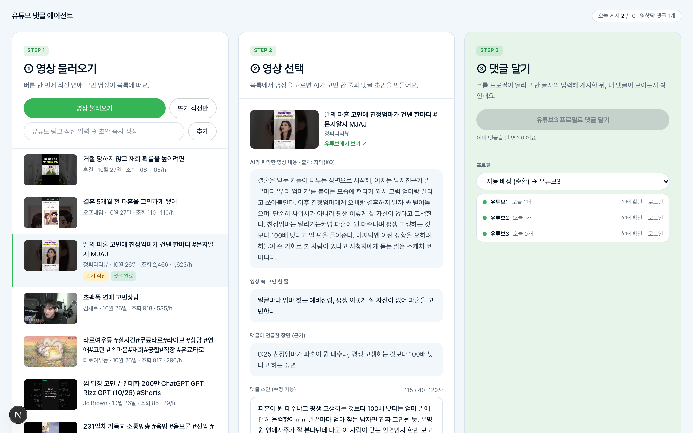

# 유튜브 댓글 에이전트 대시보드

[English](README.md) · 한국어

유튜브 영상의 내용과 맥락에 맞는 댓글을 자동으로 만들고, 사람이 확인한 뒤 전용 크롬 프로필로 게시하는 로컬 도구입니다. 예시 설정의 브랜드는 연애 사주 서비스 "운명원"이며 브랜드·키워드·상한은 설정으로 바꿀 수 있습니다.
내 컴퓨터에서 실행하는 3칸 대시보드: **① 영상 불러오기 → ② 영상 선택(고민 한 줄 + 댓글 초안) → ③ 댓글 달기(크롬 프로필이 열리고 한 글자씩 타이핑 · 게시 · 내 댓글 확인)**.



## 스택
Next.js 16 (App Router, TypeScript, Tailwind) · Playwright(실제 Chrome, persistent 프로필) · Anthropic SDK(`claude-opus-5-5`) · YouTube Data API v3 · `youtube-transcript` · Node 24 내장 `node:sqlite`

## 준비물
1. **Node 24+** (`node:sqlite` 사용) 와 **Google Chrome** 설치
2. **YouTube Data API v3 키** — Google Cloud 콘솔 → API 및 서비스 → YouTube Data API v3 사용 설정 → 사용자 인증 정보 → API 키
3. **Anthropic API 키** (크레딧 필요)
4. **구글 계정 1~3개** — 크롬 프로필 유튜브1·유튜브2·유튜브3 에 각각 로그인 (유튜브1 은 필수)

## 설치 · 실행
```bash
npm install
cp .env.example .env.local   # YOUTUBE_API_KEY, ANTHROPIC_API_KEY 채우기
npm run dev                  # http://localhost:3000
```

## 크롬 프로필 로그인 (최초 1회)
평소 쓰는 크롬 프로필은 자동 제어가 막혀 있으므로, 전용 프로필 폴더(`~/.yt-comment-agent/profiles/유튜브N`)를 Playwright `launchPersistentContext` 로 엽니다.

```bash
npm run login -- 유튜브1     # 크롬이 열리면 직접 구글 로그인 → 유튜브가 뜨면 창 닫기
```
대시보드 ③ 칸의 **로그인** 버튼도 같은 동작을 합니다. 유튜브 채널이 없는 새 계정은 유튜브에서 한 번 **채널 만들기**(이름·핸들 입력)를 해야 댓글을 달 수 있고, 댓글에는 채널 이름이 아니라 **핸들(@…)** 이 표시되므로 실명이 싫다면 핸들도 바꿔 두세요. 로그인 후 **상태 확인** 으로 초록 불이 켜지는지 확인하세요.

구글이 자동화로 띄운 크롬에서 로그인을 막는 경우, 같은 프로필 폴더로 크롬을 직접 열어 로그인하면 됩니다:
```bash
open -na "Google Chrome" --args --user-data-dir="$HOME/.yt-comment-agent/profiles/유튜브1"
```
로그인 뒤 크롬을 완전히 종료하면 Playwright 가 그 세션을 그대로 씁니다.

## 설정 (`agent.config.json`)
```json
{
  "profiles": ["유튜브1", "유튜브2", "유튜브3"],
  "comment": { "min_chars": 40, "max_chars": 120, "brand": "운명원" },
  "limits": { "daily_max_comments": 10 },
  "search": { "keywords": ["연애 고민"], "rising_keyword": "연애", "max_results": 20 },
  "model": "claude-opus-5-5",
  "data_dir": "~/.yt-comment-agent"
}
```
DB(`agent.sqlite`)·프로필·실패 스크린샷은 모두 `data_dir` 아래에 저장되며 저장소에 올라가지 않습니다.

## 운영 규칙 (서버 코드에서 강제 — `lib/store.ts` `reserveJob`)
- **영상당 댓글 1개**: 성공 기록에 부분 UNIQUE 인덱스. 같은 영상은 어떤 프로필로도 다시 달 수 없음
- **하루 게시 상한** (기본 10개, KST 기준): 시작 시점에 슬롯 예약
- **한 번에 한 작업**: 동시 게시 금지
- **기록**: 어느 영상에 · 어느 프로필로 · 무슨 댓글을 · 성공/실패(사유 + 화면 캡처) 를 시간순으로 표시

## 추가 기능
- **프로필 3개 배정**: 드롭다운에서 직접 고르거나 "자동 배정(순환)" — 가장 오래 전에 쓴 프로필부터
- **링크 직접 입력**: `watch?v=`, `youtu.be/`, `shorts/` 링크나 11자 ID → 목록에 추가되고 초안이 즉시 생성됨
- **뜨기 직전 영상 찾기**: '연애' 키워드 48시간 내 영상 중 조회수 1,000~5,000 · 시간당 150 이상만 필터 (초안까지만, 게시 버튼 비활성)

## 셀렉터 검증 스크립트
유튜브 DOM 이 바뀌면 `lib/poster.ts` 의 `SEL` 상수를 고칩니다. 확인용:
```bash
npm run spike -- 유튜브1 <videoId>            # 로그인 없이 댓글창 DOM 덤프 (~/.yt-comment-agent/spike/)
npm run spike -- 유튜브1 <videoId> "테스트 댓글"   # 실제 게시까지 (본인 채널 일부공개 영상 권장)
```

## 오픈소스
Next.js · React · Tailwind CSS · Playwright · @anthropic-ai/sdk · zod · youtube-transcript (MIT) · tsx
